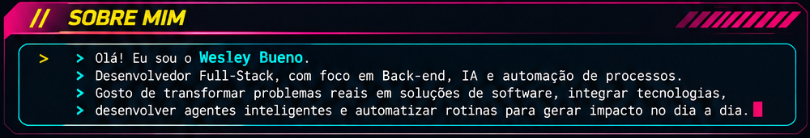
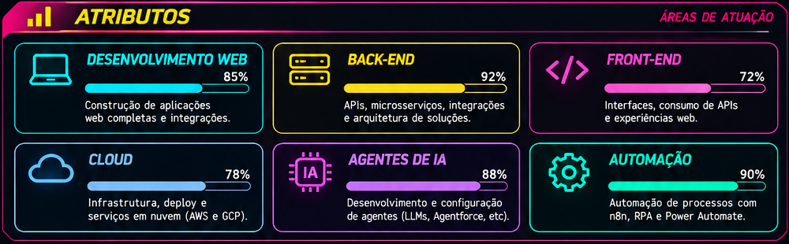
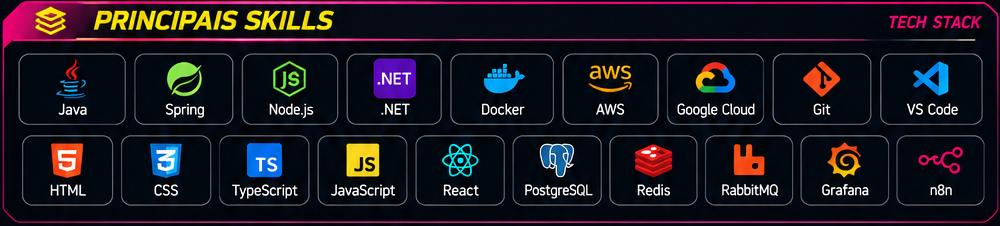
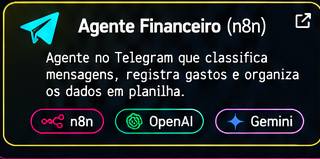
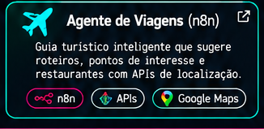
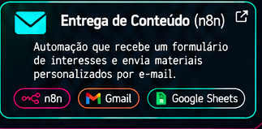
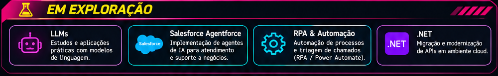
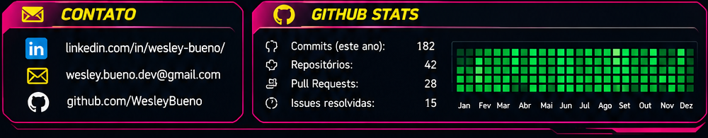

<!-- VERSÃO COM CARDS DE PROJETOS CLICÁVEIS -->

  
  
  
  
  

<!-- Altere os href para os links reais dos projetos! -->
<table align="center">
  <tr>
    <td width="33%"></td>
    <td width="33%"></td>
    <td width="33%"></td>
  </tr>
</table>

  
  
  

    <a href="https://www.linkedin.com/in/wesley-bueno/">LinkedIn</a> •
    <a href="https://github.com/WesleyBueno">GitHub</a> •
    <a href="https://github.com/WesleyBueno?tab=repositories">Repositórios</a>
  

