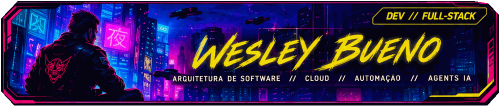
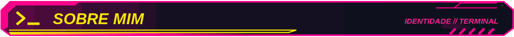
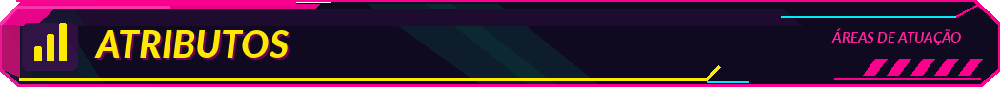
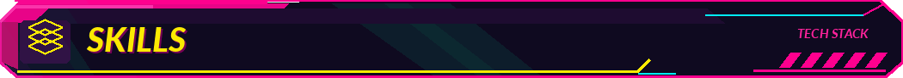
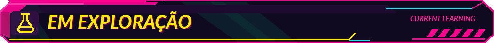

  

> **❯** Olá! Eu sou o **Wesley Bueno**. 
>
> **❯** Desenvolvedor com foco em **Back-end e Inteligência Artificial**, atuando na construção de APIs, microsserviços, integrações e soluções inteligentes.
>
> **❯** Minha experiência vai do desenho e desenvolvimento de sistemas à criação de **agentes de IA e automações que conectam LLMs, APIs e regras de negócio para resolver problemas reais**.
>
> **❯** Aqui você encontra projetos que exploram essa combinação: **engenharia e arquitetura de software, agentes inteligentes e automação aplicada.**

<table>
  <tr>
    <td width="50%" valign="top">
      
       
      <strong>⚙️ Back-end</strong>
      

        Desenvolvimento de APIs REST e microsserviços, com foco em
        integrações entre sistemas, regras de negócio e qualidade de código.
      

      

        ▹ APIs REST e microsserviços 
        ▹ Mensageria e processamento assíncrono 
        ▹ Cache e integrações 
        ▹ Testes unitários 
        ▹ Containernização 
        ▹ Desenho de arquitetura de solução
      

    </td>
    <td width="50%" valign="top">
      
       
      <strong>🤖 Agentes de IA</strong>
      

        Construção de agentes inteligentes e fluxos conversacionais,
        integrando modelos de linguagem, regras de negócio e sistemas.
      

      

        ▹ Agentes conversacionais 
        ▹ Engenharia de prompts 
        ▹ Regras e fluxos condicionais 
        ▹ Integração com sistemas
      

    </td>
  </tr>
  <tr>
    <td width="50%" valign="top">
      
       
      <strong>🔄 Automação</strong>
      

        Desenvolvimento de automações para conectar plataformas,
        processar informações e reduzir tarefas manuais em processos.
      

      

        ▹ Orquestração de workflows 
        ▹ Integração entre plataformas 
        ▹ Triagem automatizada 
        ▹ Processamento de dados
      

    </td>
    <td width="50%" valign="top">
      
       
      <strong>☁️ Cloud & DevOps</strong>
      

        Aplicação de práticas de containerização, observabilidade
        e serviços em nuvem para apoiar soluções de software.
      

      

        ▹ Containerização de aplicações cloud 
        ▹ Monitoramento 
        ▹ Serveless 
        ▹ Modernização de APIs
      

    </td>
  </tr>
</table>

<table width="100%">
<tr>
<td width="50%" valign="top">
   
  <strong>💳 Agente Financeiro</strong> 
  Agente no Telegram que identifica despesas, classifica mensagens e organiza os registros em uma planilha. 
  <code>n8n · Telegram Bot API · Gemini · OpenAI · Google Sheets</code>
</td>
<td width="50%" valign="top">
   
  <strong>✈️ Agente de Viagens</strong> 
  Guia que sugere roteiros, restaurantes e pontos de interesse usando dados de localização. 
  <code>n8n · LLMs · APIs de localização</code>
</td>
</tr>
<tr>
<td width="50%" valign="top">
   
  <strong>✉️ Entrega de Conteúdo</strong> 
  Automação que recebe interesses de um formulário e envia materiais por e-mail. 
  <code>n8n · Gmail · Formulários</code>
</td>
<td width="50%" valign="top">
   
  <strong>🤖 Agentes de IA</strong> 
  Experimentação com fluxos condicionais, regras de negócio e agentes para apoio a processos. 
  <code>LLMs · Agent Builder · Salesforce Agentforce</code>
</td>
</tr>
</table>

  

<table width="100%">
  <tr>
    <td width="50%" valign="top">
      <strong><code>// BACK-END & Arquitetura de Software </code></strong> 
      Base principal de desenvolvimento de APIs, integrações e arquitetura de serviços.
        
      
      
      
      
      
      
      
      
    </td>
    <td width="50%" valign="top">
      <strong><code>// IA & AUTOMAÇÃO</code></strong> 
      Construção de agentes, fluxos inteligentes e automações conectadas a regras de negócio.
        
      
      
      
      
      
    </td>
  </tr>

  <tr>
    <td width="50%" valign="top">
      <strong><code>// CLOUD</code></strong> 
      Infraestrutura, observabilidade e ferramentas de suporte ao ciclo de desenvolvimento.
        
      
      
      
      
    </td>
    <td width="50%" valign="top">
      <strong><code>// FRONT-END</code></strong> 
      Tecnologias complementares para interface, integração e desenvolvimento full-stack.
        
      
      
      
      
    </td>
  </tr>
</table>

<table width="100%"><tr>
<td width="25%" valign="top"><strong>🧠 LLMs</strong> Prompting, avaliação e arquiteturas de agentes.</td>
<td width="25%" valign="top"><strong>☁️ Salesforce Agentforce</strong> Agentes de atendimento e integração com regras de negócio.</td>
<td width="25%" valign="top"><strong>⚙️ RPA &amp; Automação</strong> Triagem e validação de chamados com Power Automate.</td>
<td width="25%" valign="top"><strong>💠 .NET &amp; Cloud</strong> Migração e modernização de APIs em ambientes cloud.</td>
</tr></table>

<code>END TRANSMISSION // BUILDING BETTER SYSTEMS</code>

