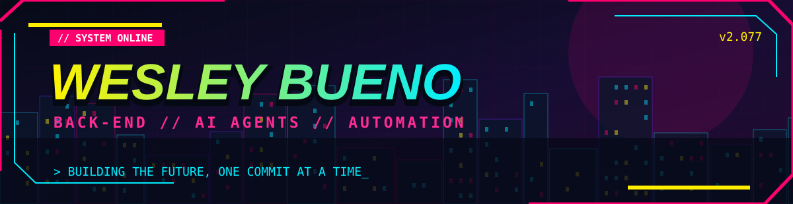
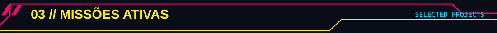

<div align="center">



  

`[ NIGHT CITY NETWORK ]` · `SÃO PAULO / BR` · `BUILD 2.077`

</div>


```text
> carregando_perfil.exe
> identificação: Wesley Bueno
> ocupação: Desenvolvedor Back-end | Estudante de Engenharia de Software
> especialidade: APIs • Integrações • Agentes de IA • Automação
> status: aprendendo, construindo, evoluindo...
> processo finalizado: OK
```

Desenvolvedor com experiência em **Java, APIs REST, microsserviços e integrações**, atualmente atuando como **estagiário de Back-end na GFT Brasil**. Também exploro **agentes de IA**, **n8n**, **automações de processos** e maneiras de transformar problemas reais em soluções úteis.

<div align="center">

<sub>Os níveis acima são ilustrativos, inspirados em sistemas de progressão de RPG.</sub>
</div>


<div align="center">

**CORE // BACK-END & INTEGRAÇÕES**

     

**TOOLS // OBSERVABILIDADE & INFRA**

     

**AI // AUTOMAÇÃO & EXPERIMENTAÇÃO**

   

</div>



<table>
<tr>
<td width="50%" valign="top">

### `01 // FINANCE BOT`
**Agente financeiro no Telegram**

Classifica mensagens, identifica despesas e consultas e organiza registros financeiros em planilhas.

`n8n` `Telegram Bot API` `LLMs` `Google Sheets`

</td>
<td width="50%" valign="top">

### `02 // TRAVEL AGENT`
**Agente de viagens inteligente**

Sugere roteiros, locais de interesse e restaurantes utilizando APIs de localização.

`n8n` `LLMs` `Location APIs`

</td>
</tr>
<tr>
<td width="50%" valign="top">

### `03 // CONTENT DELIVERY`
**Entrega automatizada de conteúdo**

Recebe interesses de um formulário e automatiza o envio de materiais por e-mail.

`n8n` `Gmail` `Forms`

</td>
<td width="50%" valign="top">

### `04 // AGENT ARCHITECTURE`
**Agentes de IA aplicados a processos**

Exploração de fluxos condicionais, regras de negócio e integração com sistemas de atendimento.

`Agent Builder` `Salesforce` `AI Agents`

</td>
</tr>
</table>

> [!NOTE]
> Os cards descrevem projetos e experiências. Adicione links apenas para repositórios que você realmente publicou; projetos internos podem permanecer sem links.


```text
  [x] APIs REST e microsserviços       [x] Java / Spring
  [x] Mensageria com RabbitMQ          [x] Docker e Redis
  [x] Observabilidade                  [x] Workflows com n8n
  [>] Arquitetura de agentes de IA     [>] Salesforce Agentforce
  [>] RPA e automação de triagem       [>] Cloud e .NET
```


<div align="center">

[](https://www.linkedin.com/in/wesley-bueno/)
[](https://github.com/WesleyBueno?tab=repositories)

```text
> TRANSMISSION COMPLETE
> NEVER STOP LEVELING UP_
```

</div>
