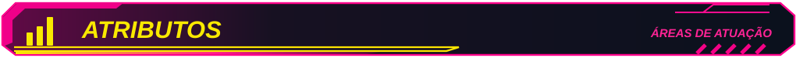
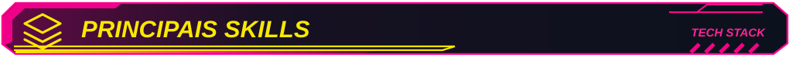
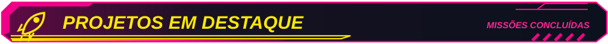
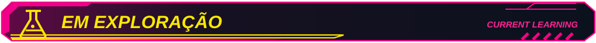
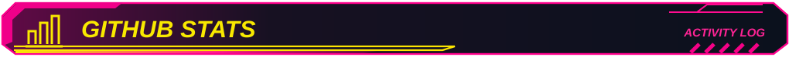

<!--
  WESLEY BUENO // CYBERPUNK README
  INSTALAÇÃO: envie este README.md e a pasta assets/ para a raiz do repositório WesleyBueno/WesleyBueno.
  PERSONALIZAÇÃO: textos, áreas, badges e projetos são editáveis neste arquivo.
  VISUAL: somente o banner e os TÍTULOS são imagens locais.
  Não utiliza CSS/JS que o GitHub bloquearia.
-->

  

<!-- ============ 01 // SOBRE MIM ============ -->

> **❯** Olá! Eu sou o **Wesley Bueno**.
>
> **❯** Sou desenvolvedor Full-Stack e estudante de Engenharia de Software, com foco em **Back-end, agentes de IA e automação de processos**.
>
> **❯** Atuo com **APIs REST, microsserviços e integrações**. Gosto de transformar problemas reais em soluções de software e explorar formas de automatizar o trabalho do dia a dia.
>
> **❯** Atualmente, desenvolvo minhas habilidades em Back-end na **GFT Brasil** e estudo aplicações práticas de IA.

<!-- ============ 02 // ATRIBUTOS ============ -->

<!-- Edite os textos das 6 células abaixo. A cor dos rótulos vem da URL da badge. -->
<table width="100%">
<tr>
<td width="33%" valign="top" align="left">
   
  <strong>🌐 Desenvolvimento Web</strong> 
  Aplicações web, integração de serviços e construção de soluções ponta a ponta.
</td>
<td width="33%" valign="top" align="left">
   
  <strong>⚙️ Back-end</strong> 
  APIs REST, microsserviços, mensageria e regras de negócio.
</td>
<td width="33%" valign="top" align="left">
   
  <strong>🎨 Front-end</strong> 
  Interfaces web, HTML, CSS, JavaScript e TypeScript.
</td>
</tr>
<tr>
<td width="33%" valign="top" align="left">
   
  <strong>☁️ Cloud</strong> 
  Serviços em nuvem, containerização e observabilidade.
</td>
<td width="33%" valign="top" align="left">
   
  <strong>🤖 Agentes de IA</strong> 
  LLMs, fluxos conversacionais e aplicação de regras de negócio.
</td>
<td width="33%" valign="top" align="left">
   
  <strong>🔄 Automação</strong> 
  Fluxos com n8n, integrações de APIs e automações RPA.
</td>
</tr>
</table>

<!-- ============ 03 // SKILLS ============ -->

<strong><code>CORE // BACK-END &amp; INTEGRAÇÕES</code></strong>

<strong><code>DEVOPS // CLOUD &amp; DADOS</code></strong>

<strong><code>WEB // IA &amp; AUTOMAÇÃO</code></strong>

<!-- ============ 04 // PROJETOS ============ -->

<!-- Os cards são editáveis. Se publicar repositórios individuais, adicione links nos títulos. -->
<table width="100%">
<tr>
<td width="50%" valign="top">
   
  <strong>💳 Agente Financeiro</strong> 
  Agente no Telegram que identifica despesas, classifica mensagens e organiza os registros em uma planilha. 
  <code>n8n · Telegram Bot API · Gemini · OpenAI · Google Sheets</code>
</td>
<td width="50%" valign="top">
   
  <strong>✈️ Agente de Viagens</strong> 
  Guia que sugere roteiros, restaurantes e pontos de interesse usando dados de localização. 
  <code>n8n · LLMs · APIs de localização</code>
</td>
</tr>
<tr>
<td width="50%" valign="top">
   
  <strong>✉️ Entrega de Conteúdo</strong> 
  Automação que recebe interesses de um formulário e envia materiais por e-mail. 
  <code>n8n · Gmail · Formulários</code>
</td>
<td width="50%" valign="top">
   
  <strong>🤖 Agentes de IA</strong> 
  Experimentação com fluxos condicionais, regras de negócio e agentes para apoio a processos. 
  <code>LLMs · Agent Builder · Salesforce Agentforce</code>
</td>
</tr>
</table>

<!-- ============ 05 // EM EXPLORAÇÃO ============ -->

<table width="100%"><tr>
<td width="25%" valign="top"><strong>🧠 LLMs</strong> Prompting, avaliação e arquiteturas de agentes.</td>
<td width="25%" valign="top"><strong>☁️ Salesforce Agentforce</strong> Agentes de atendimento e integração com regras de negócio.</td>
<td width="25%" valign="top"><strong>⚙️ RPA &amp; Automação</strong> Triagem e validação de chamados com Power Automate.</td>
<td width="25%" valign="top"><strong>💠 .NET &amp; Cloud</strong> Migração e modernização de APIs em ambientes cloud.</td>
</tr></table>

<!-- ============ 06 // CONTATO ============ -->

<!-- Para adicionar seu e-mail, descomente e troque o endereço abaixo, após confirmar:

<a href="mailto:SEU_EMAIL@EXEMPLO.COM">✉️ Enviar e-mail</a>

-->

<!-- ============ 07 // GITHUB STATS ============ -->

<!-- Dados dinâmicos de serviço terceirizado; se não carregar, consulte INSTRUCOES.md. -->

  
  

<code>END TRANSMISSION // BUILDING BETTER SYSTEMS</code>

